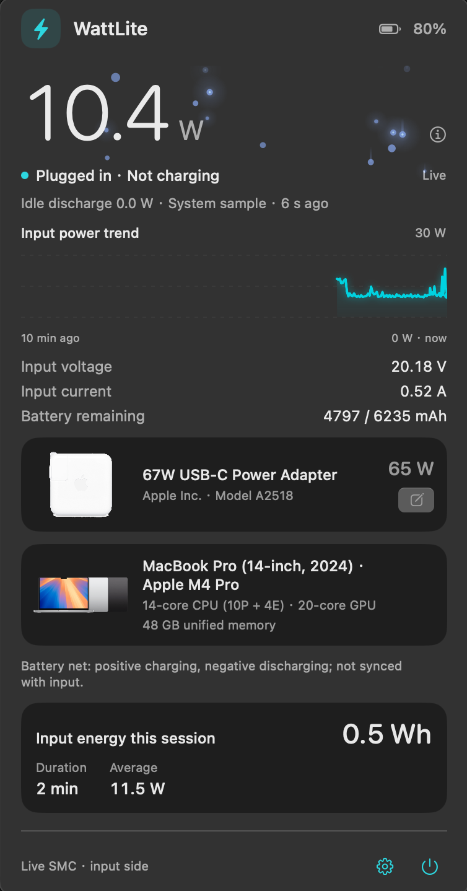
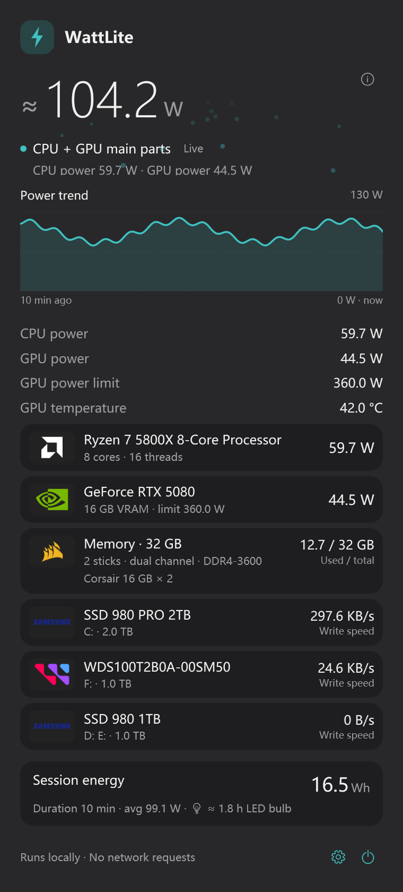
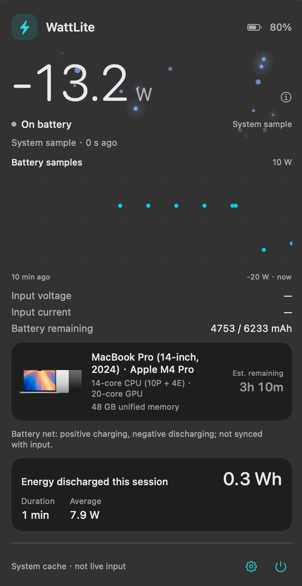
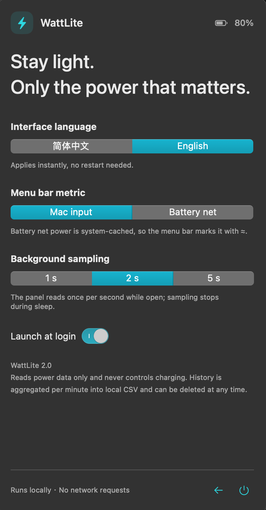

# WattLite

<p align="center">
  <b>Live power, at a glance — now on macOS and Windows.</b><br>
  One number answers the question that matters:<br>
  how many watts is this machine drawing right now?
</p>

<p align="center">
  <a href="https://github.com/GabrielZZZ/WattLite/releases/tag/v2.1"></a>
  <a href="https://github.com/GabrielZZZ/WattLite/releases/tag/v0.1.0-windows"></a>
  
  
  
  <a href="https://gabrielzzz.github.io/WattLite/"></a>
</p>

<p align="center"><b>English</b> · <a href="README.zh-CN.md">简体中文</a> · <a href="https://gabrielzzz.github.io/WattLite/">Website</a></p>

<p align="center">
  
  
</p>
<p align="center"><sub>macOS menu bar panel · Windows taskbar panel</sub></p>

WattLite is a native power monitor for both platforms. It shows the power the machine is actually drawing, keeps a short trend, and breaks the number down by component — without controlling hardware, reading serial numbers, or making a single network request.

- **macOS** reads SMC input power and battery net power straight from the I/O Kit.
- **Windows** combines CPU package power from LibreHardwareMonitor with NVIDIA GPU power from `nvidia-smi`. The main number is marked `≈` because it is the sum of the main components, not wall power.

## Platform overview

| | macOS | Windows |
| --- | --- | --- |
| Status | v2.1, stable | v0.1.0, first release (pre-release) |
| Lives in | Menu bar (`LSUIElement`, no Dock icon) | Taskbar badge next to the tray |
| Main number | SMC input power / battery net power | CPU package + NVIDIA GPU power (`≈`) |
| Cards | Adapter, Mac model, battery, session energy | CPU, GPU, memory, one card per physical disk |
| Extras | Adapter artwork, Mac model artwork, battery view | Drive letters, per-disk write speed, light/dark switch |
| Requirements | Apple Silicon, macOS 14+ | Windows 10 1809+/11 x64, NVIDIA driver, administrator |
| Download | `WattLite-2.1.dmg` | `WattLite-0.1.0-windows-x64-setup.exe` (installer) or the portable `.zip` |
| Source | [`Sources/`](Sources) | [`windows/`](windows) |

## macOS

### Menu bar

One monospaced number with a fixed width, so it never shoves the rest of your menu bar sideways when it jumps.

- **Bolt icon** carries an energy-flow animation: upward while charging, downward on battery, a slow ambient drift when plugged in but not charging.
- **Cached values** are prefixed with `≈` instead of pretending to be real time.
- **Format** reads `⚡ 67W · In 10.2 W`.

<p align="center">
  
</p>

### Panel

| Block | Shows | Source |
| --- | --- | --- |
| Big number | Input power or battery net power | SMC key `PDTR`, read-only I/O Kit call (`Sources/SMC.c`) |
| Particle flow | Faster when the machine draws more | Local animation, no extra sampling |
| Trend | Last 10 minutes | 1 sample / second while the panel is open |
| Input voltage / current | Instantaneous V and A | Same SMC batch |
| Battery capacity | Current / full-charge mAh | `AppleSmartBattery` |
| Adapter card | Name, vendor, model, rated watts, product art | `AdapterDetails` + USB PD `FedDetails` |
| Mac card | Exact marketing name, CPU/GPU cores, memory | `system_profiler` + identifier lookup table |
| Session energy | Wh, duration, average since plugged in, one everyday comparison | Integrated from samples |

**Battery net power** = voltage × signed current: positive is charging, negative is discharging. The system refreshes it roughly once a minute, out of phase with the instantaneous input reading, so the panel deliberately **does not** subtract one from the other.

**What `PDTR` means.** It is input power measured *inside* the Mac — the wall outlet sees more, because the adapter itself burns some.

Unplugged, the same panel switches to the battery view: the trend becomes discrete battery samples, the Mac card gains an estimated time remaining, and the session card counts energy given out instead of taken in.

**Everyday comparisons.** The session card closes with one relatable rung, chosen from nine: 🍌 banana, 🔋 AA cell, 💡 LED bulb, 💧🫖 boiled water by the mug and by the litre, 📺 TV, 💨 hair dryer, ⚡ 1 kWh, 🚗 EV kilometres. It always picks the largest rung the session has actually reached, so the count never drops below 1. The banana, the AA cell and both boil-water rungs are exact arithmetic; the appliance rungs are nameplate watts × a typical duration, which is why every line carries `≈`.

<p align="center">
  
</p>

### Settings

<p align="center">
  
</p>

| Setting | Options |
| --- | --- |
| Interface language | 简体中文 / English, applied instantly |
| Menu bar metric | Mac input power / battery net power |
| Background sampling | 1 / 2 / 5 seconds |
| Launch at login | on / off |

While the panel is open it samples once per second regardless; sampling stops on sleep and restarts on wake.

### Install

#### Download (recommended)

Grab `WattLite-2.1.dmg` from [**Releases**](https://github.com/GabrielZZZ/WattLite/releases/latest) and drag WattLite into `Applications`.

The first launch needs one manual approval: this project has no Apple Developer account, so the build is ad-hoc signed and not notarised, and Gatekeeper blocks every copy that arrives through a browser. Either

- open **System Settings → Privacy & Security** and click **Open Anyway** next to "WattLite was blocked", or
- clear the quarantine flag with `xattr -dr com.apple.quarantine /Applications/WattLite.app`

`WattLite-2.1.zip` works too, but **extract it by double-clicking or with `ditto -x -k`** — `unzip` leaves `._*` resource forks inside the bundle and breaks the signature seal.

After that the menu bar shows `⚡ 67W · In 10.2 W`. Click it for the panel, and turn on **Launch at login** if you want it permanent.

#### Build from source

```bash
git clone https://github.com/GabrielZZZ/WattLite.git && cd WattLite
bash build.sh                        # runs the self-checks, then emits build/WattLite.app
open build/WattLite.app

bash build.sh release                # additionally emits build/WattLite-<version>.{dmg,zip}
```

Xcode command line tools only (`xcode-select --install`). No Xcode project, no SwiftPM, no third-party dependencies. Requires Apple Silicon and macOS 14+.

#### Self-checks

The self-check is a plain `precondition` executable covering power decoding, edge cases and stale data, session energy integration, and the model identifier table.

```bash
build/checks             # PASS: ...
build/checks --live      # samples 8 more seconds and cross-checks SMC against V×I
```

### Model and artwork detection

`system_profiler` only returns a generic name ("MacBook Pro"). The exact marketing name comes from a 72-entry identifier table in `Sources/MacModels.swift`, sourced from Apple's official model identification pages. Artwork is keyed by identifier, because one marketing name can ship different hardware looks (M4 vs M4 Pro/Max).

Lookup is **user directory first, bundle second**, tried key by key:

```text
~/Library/Application Support/WattLite/adapters/<key>.png   # yours
Contents/Resources/Adapters/<key>.png                       # shipped
```

- **Mac**: `mac16-8` (identifier) → `macbook-pro` (generic)
- **Adapter**: `apple-67w` (Apple bricks, by wattage) → `22D9:001B` (third party, by VID:PID)

Shipped: 72 official Mac product images + 9 Apple adapter images (20/29/35/61/67/70/87/96/140 W), all normalised to 600×600 transparent squares with the cable cropped out.

Third-party chargers usually report nothing but `pd charger` over USB PD, so there is nothing to auto-detect — the pencil button on the adapter card lets you set name / model / protocol and upload your own product image. Entries are saved to `adapters.json` and override the built-ins.

### History

Aggregated per minute into a local CSV:

```text
~/Library/Application Support/WattLite/history/YYYY-MM-DD.csv
# ts,input_w,battery_w,percent,full_charge_mah,connected
```

The CSV *is* the export format — no database, no background uploader. Delete the folder to wipe everything.

## Windows

<p align="center">
  
</p>

<p align="center">
  
</p>
<p align="center"><sub>Taskbar badge · light/dark appearance and language settings</sub></p>

The Windows build is a native WPF app. It places a transparent, always-on-top badge just left of the tray, so the number lives in the taskbar without stealing focus, covering the clock, or showing a window border. Clicking it opens the same kind of panel as the macOS version.

### What you get

- **Taskbar badge** with live CPU package + GPU power. It follows the Windows taskbar's light/dark state and hides itself whenever a fullscreen app covers the taskbar.
- **Power panel** with a big number, a 10-minute trend, CPU / GPU / memory cards and one card per physical disk — each with its vendor logo, model, capacity, drive letters (`C:`, `D: E:`, …) and its own write speed.
- **Manual light/dark appearance** in Settings, applied instantly to the whole panel and persisted.
- **Chinese / English UI**, also switchable without a restart.
- **Local-only history**: per-minute CSV, no network requests, no telemetry.

### Install

Download `WattLite-0.1.0-windows-x64-setup.exe` from the [Windows release](https://github.com/GabrielZZZ/WattLite/releases/tag/v0.1.0-windows) and run it. Setup installs to `C:\Program Files\WattLite`, adds a Start Menu shortcut (and an optional desktop shortcut) and an entry under Apps & Features. A portable `WattLite-0.1.0-windows-x64.zip` is available on the same release; extract it and run `WattLite.exe` without installing.

- Windows 10 1809+ or Windows 11, x64. Both builds are self-contained, so no .NET install is needed.
- **Administrator rights are required**: setup writes to Program Files, and the app itself needs elevation because CPU package power goes through LibreHardwareMonitor/PawnIO and disk counters use `IOCTL_DISK_PERFORMANCE`. Accept the UAC prompt.
- Setup and the executable are not code-signed. If SmartScreen shows "Windows protected your PC", choose **More info → Run anyway**.
- GPU power, temperature, power limit and VRAM need an NVIDIA driver with `nvidia-smi`. Without it, the CPU side still works.
- Uninstalling keeps settings and history in `%APPDATA%\WattLite`; delete that folder to reset everything.

### Build from source

```powershell
dotnet build windows/WattLite/WattLite.csproj -c Release
dotnet run --project windows/Checks/Checks.csproj   # nvidia-smi parser smoke test

dotnet publish windows/WattLite/WattLite.csproj -c Release -r win-x64 `
  --self-contained true -p:PublishSingleFile=false -p:DebugType=None -o publish

.\windows\installer\build-installer.ps1 -PublishDir .\publish -Version 0.1.0
```

Requires the .NET 8 SDK and Inno Setup 6 on the build machine. The installer script lives in [`windows/installer/`](windows/installer); the zip is the published folder plus `README.txt` and `LICENSE`. See [`windows/README.md`](windows/README.md) for details.

### Windows history

```text
%APPDATA%\WattLite\history\YYYY-MM-DD.csv
# ts,cpu_w,gpu_w,temperature
```

Settings live next to it in `%APPDATA%\WattLite\settings.json`. Delete the folder to reset the app.

## Privacy & data

Neither version makes network requests, collects telemetry, requires an account, or reads serial numbers. Settings and history never leave the machine: macOS keeps them under `~/Library/Application Support/WattLite`, Windows under `%APPDATA%\WattLite`. Delete those folders to erase everything.

## Known limitations

### macOS

- **Ad-hoc signed, not notarised** (no Apple Developer account). Downloaded copies need the one-off approval above; a build you compiled yourself is unaffected.
- **Not calibrated against an external power meter.** `PDTR` is machine-side input power, not wall power.
- **Apple Silicon only**: `build.sh` hardcodes `arm64-apple-macosx14.0`. Add a universal target yourself for Intel.
- **Missing artwork**: no official art available for the 30 W / 240 W Apple adapters. The adapter `Model` hex → A-number table has only two field-verified entries (`0x7016 → A2518`, `0x7002 → A2166`); there is no authoritative public source for the rest, so we do not guess.

### Windows

- The main number is **CPU package + GPU only**; it excludes the motherboard, memory, disks and PSU conversion loss, so it is not wall power. It carries `≈` for that reason.
- GPU readings currently require an **NVIDIA GPU and driver** (`nvidia-smi`). CPU, memory and disk readings still work without one.
- The app requires **administrator rights**, and the binary is unsigned, so SmartScreen may warn on first launch.
- There is no installer yet — the release is a self-contained `.zip`.
- Drive letters come from WMI partition associations; unusual storage layouts (Storage Spaces, dynamic disks) may not map every volume.
- The Windows port is at **0.1.0** and marked as a pre-release while it gets real-world mileage.

## Release notes

**Windows v0.1.0** — first native Windows release (pre-release).

- Transparent taskbar badge with live CPU package + GPU power; auto-hides when a fullscreen app covers the taskbar
- macOS-style panel: big number, 10-minute trend, CPU / GPU / memory / per-disk cards with vendor logos
- Each physical disk shows its drive letters (`C:`, `D: E:`, …) and its own write speed
- Manual light/dark appearance, Chinese/English UI, persisted settings
- Local-only CSV history in `%APPDATA%\WattLite\history`; no network requests
- Standard installer (Program Files, Start Menu/optional desktop shortcut, uninstall entry, Chinese/English wizard) plus a portable zip; both self-contained x64, administrator rights required
- Branded app icon and file metadata

**macOS v2.1** — session energy now speaks in everyday units.

- The session card closes with one comparison line, picked from nine rungs (banana → AA cell → LED bulb → boiled water → TV → hair dryer → kWh → EV kilometres), always the largest rung reached so the count is ≥ 1
- Same line in both interface languages; VoiceOver gets it as plain text without the emoji

**macOS v2.0** — first packaged release, downloadable as `.dmg` / `.zip`.

- Mac model resolved to its exact marketing name (72-entry identifier table) and matched to official artwork by identifier
- 9 Apple adapter wattage classes shipped, normalised to transparent squares, brick only
- Third-party chargers can be described by hand (name / model / protocol + your own image); user entries override built-ins
- Session energy card added (Wh, duration, average)
- Panel reduced to one big number with power-driven particles; popover height pinned so it stops resizing between adapter and battery states
- Full English interface, switchable from Settings without restarting

## License

MIT, see [LICENSE](LICENSE).

- macOS product images under `Assets/Adapters/` are Apple's own assets and remain © Apple Inc.
- Windows vendor logos under `windows/WattLite/Assets/vendors/` are trademarks of their respective owners; they are used only to identify installed hardware.
- The Windows build depends on [LibreHardwareMonitorLib](https://github.com/LibreHardwareMonitor/LibreHardwareMonitor) (MPL-2.0) and calls NVIDIA's `nvidia-smi` for GPU telemetry.
