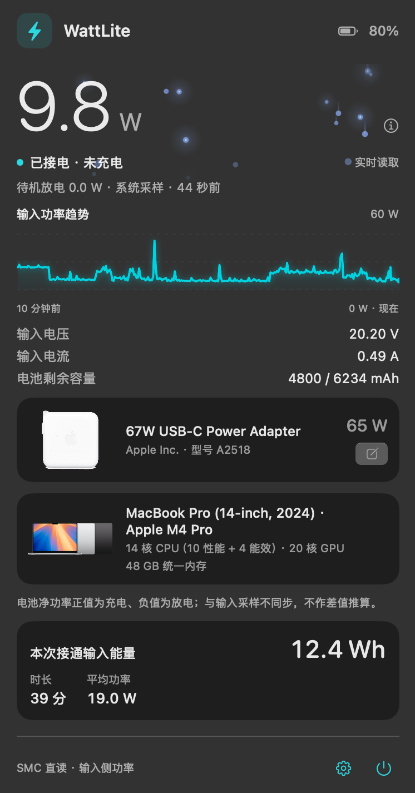
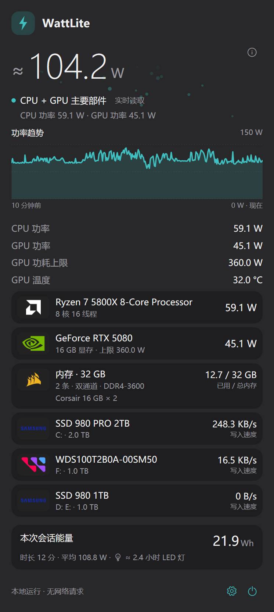
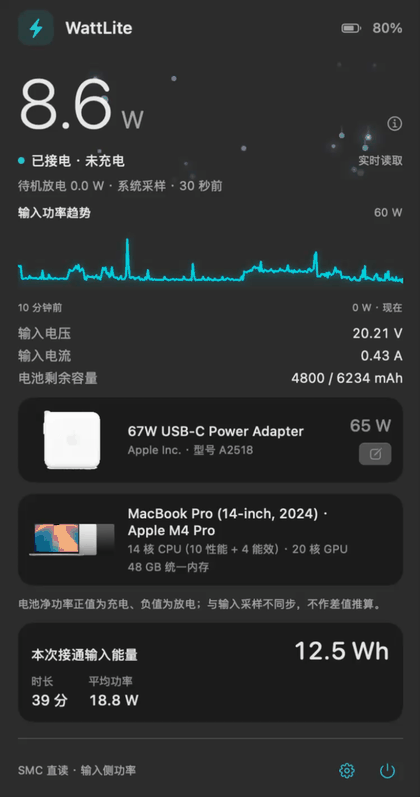
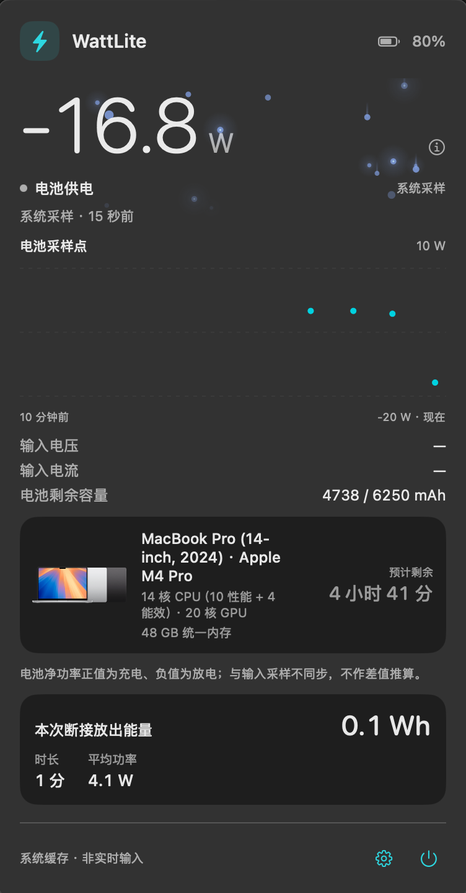
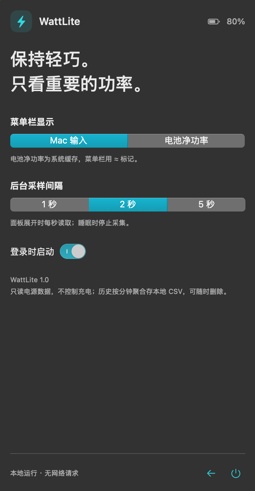
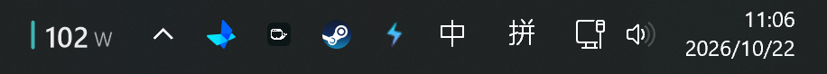
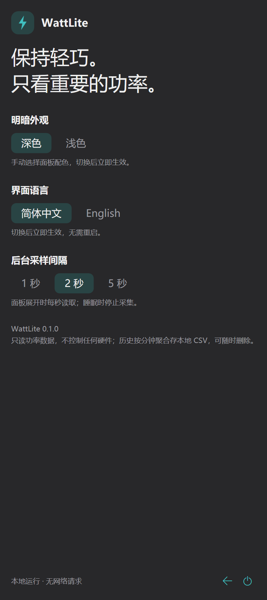

# WattLite

<p align="center">
  <b>实时功率，一眼掌握——现在支持 macOS 与 Windows。</b><br>
  只回答一个问题：<br>
  这台机器此刻到底吃进多少瓦？
</p>

<p align="center">
  <a href="https://github.com/GabrielZZZ/WattLite/releases/tag/v2.2"></a>
  <a href="https://github.com/GabrielZZZ/WattLite/releases/tag/v1.0.0-windows"></a>
  
  
  
  <a href="https://gabrielzzz.github.io/WattLite/"></a>
</p>

<p align="center"><a href="README.md">English</a> · <b>简体中文</b> · <a href="https://gabrielzzz.github.io/WattLite/">官网</a></p>

<p align="center">中国大陆下载慢？<a href="https://gabrielzzz.github.io/WattLite/?line=mirror#download"><b>使用国内加速线路</b></a>（第三方代理，可核对 SHA-256）</p>

<p align="center">
  
  
</p>
<p align="center"><sub>macOS 菜单栏面板 · Windows 任务栏面板</sub></p>

WattLite 是 macOS 与 Windows 上的原生功率监视器：显示机器此刻的真实功耗、保留一段趋势，并按部件拆开看——不控制硬件、不读取序列号、不采集遥测。唯一的网络行为是可关闭的签名更新检查。

- **macOS** 直接通过 I/O Kit 读取 SMC 输入功率和电池净功率。
- **Windows** 把 LibreHardwareMonitor 的 CPU 封装功率与 GPU 功率相加（NVIDIA / AMD / Intel），NVIDIA 的功耗上限与显存来自 `nvidia-smi`；主数字带 `≈`，因为这是主要部件之和，不是插座端功率。

## 平台概览

| | macOS | Windows |
| --- | --- | --- |
| 状态 | v2.2，稳定版 | v1.0.0，稳定版 |
| 常驻位置 | 菜单栏（`LSUIElement`，无 Dock 图标） | 托盘左侧的任务栏徽标 |
| 主数字 | SMC 输入功率 / 电池净功率 | CPU 封装 + GPU 功率（`≈`） |
| 卡片 | 适配器、本机、电池、会话能量 | CPU、GPU、内存、每块物理盘 |
| 额外信息 | 适配器/机型产品图、电池视图 | 盘符、逐盘写入速度、手动明暗 |
| 更新 | 签名自动更新 | 签名自动更新（免安装版只提示） |
| 要求 | Apple Silicon、macOS 14+ | Windows 10 1809+/11 x64、管理员；GPU 传感器需要 NVIDIA / AMD / Intel 驱动 |
| 下载 | `WattLite-2.2.dmg` | `WattLite-1.0.0-windows-x64-setup.exe`（安装版）或免安装 `.zip` |
| 源码 | [`Sources/`](Sources) | [`windows/`](windows) |

## 自动更新

两个平台都会在启动 20 秒后检查一次，之后每 6 小时检查。更新清单使用 ECDSA P-256 签名，下载文件必须通过 SHA-256 校验才会被允许替换。macOS 由一个临时 helper 替换 `.app` 并重启；Windows 静默运行安装器并自动重启。设置里可以关闭自动检查，仍可手动检查。Windows 免安装版不会替换自身，只提示新版本并打开下载页。

这是第一个带自动更新的版本。macOS 2.1 或 Windows 0.1.1 的用户需要手动安装一次 2.2 / 1.0.0，之后的版本即可原地升级。

## macOS

### 菜单栏

一个等宽数字，宽度固定，跳数时不左右挤动。

- **bolt 图标**带能量流动画：充电上行 / 放电下行 / 接电未充慢速环境流。
- **缓存值**会显式加 `≈` 标记，不冒充实时值。
- **格式**为 `⚡ 67W · 入 10.2 W`。

<p align="center">
  
</p>

### 面板

<p align="center">
  
  
</p>

<p align="center"><sub>左：实时面板 · 右：电池供电状态</sub></p>

| 区块 | 内容 | 来源 |
| --- | --- | --- |
| 大数字 | 输入功率或电池净功率 | SMC `PDTR`，IOKit 只读调用（`Sources/SMC.c`） |
| 粒子流 | 功率越大流动越快 | 本地动画，无额外采样 |
| 趋势 | 近 10 分钟曲线 | 面板展开时每秒采样 |
| 输入电压 / 电流 | 瞬时 V、A | 同一批 SMC 读数 |
| 电池剩余容量 | 当前 / 满充 mAh | `AppleSmartBattery` |
| 适配器卡 | 名称、厂商、型号、额定功率、产品图 | `AdapterDetails` + USB PD `FedDetails` |
| 本机卡 | 精确营销名、CPU/GPU 核心、内存 | `system_profiler` + 标识符查表 |
| 本次接通输入能量 | Wh、时长、平均功率、一个生活化换算 | 采样积分 |

**电池净功率** = 电压 × 有符号电流，正值充电、负值放电；系统约每分钟更新一次，与输入瞬时值不同步，所以面板**不做两者差值推算**。

拔掉电源后同一个面板切到电池视图（上图右侧）：趋势变成离散的电池采样点，本机卡多出一项预估剩余时间，能量卡改为统计放出而非吃进的能量。

**生活化换算**：能量卡右下角给一条看得懂的参照，共 9 档——🍌 香蕉、🔋 5 号电池、💡 LED 灯、💧🫖 烧水（一杯 / 一升）、📺 电视、💨 吹风机、⚡ 1 度电、🚗 电动车公里数。取的是「本次能量真正达到过的最高一档」，所以数字恒 ≥ 1，不会出现 ≈ 0.05 节电池。香蕉、5 号电池和两档烧水是精确算出来的；电器那几档是「标称功率 × 典型时长」的量级估算，所以每条都带 `≈`。

界面完整支持英文，设置里切换立即生效、无需重启。

### 设置

<p align="center">
  
</p>

| 设置项 | 可选值 |
| --- | --- |
| 界面语言 | 简体中文 / English，切换立即生效 |
| 菜单栏指标 | Mac 输入功率 / 电池净功率 |
| 后台采样间隔 | 1 / 2 / 5 秒 |
| 登录时启动 | 开 / 关 |
| 软件更新 | 自动检查开关、手动检查、重启并更新 |

面板展开时固定每秒采样，睡眠时停止采集并在唤醒后重新采样。

### 安装

#### 直接下载（推荐）

从 [**macOS Release**](https://github.com/GabrielZZZ/WattLite/releases/tag/v2.2) 下载 `WattLite-2.2.dmg`，打开后把 WattLite 拖进 `Applications`。

首次打开需要放行一次：项目没有 Apple Developer 账号，因此是 ad-hoc 签名、未经公证，Gatekeeper 会拦下所有从浏览器下载的副本。二选一：

- **系统设置 → 隐私与安全性**，在“已阻止使用 WattLite”处点 **仍要打开**；
- 终端去掉隔离标记：`xattr -dr com.apple.quarantine /Applications/WattLite.app`

也可以用 `WattLite-2.2.zip`，但**必须双击或用 `ditto -x -k` 解压**——`unzip` 会把资源派生数据解成一堆 `._` 文件留在包里，签名封条当场失效。

装好后菜单栏出现 `⚡ 67W · 入 10.2 W`，点它展开面板。设置里可打开**登录时启动**。

装好 2.2 之后，后续版本会在应用内下载。设置页会显示当前版本、自动检查开关、手动检查按钮和**重启并更新**。更新只替换 `/Applications/WattLite.app`，设置与历史仍留在 `~/Library/Application Support/WattLite`。如果应用从挂载的 DMG、App Translocation 或其他只读位置运行，WattLite 会跳过自动下载，改为提供下载页。

#### 从源码构建

```bash
git clone https://github.com/GabrielZZZ/WattLite.git && cd WattLite
bash build.sh                        # 先跑自检，再产出 build/WattLite.app
open build/WattLite.app

bash build.sh release                # 额外产出 build/WattLite-<版本>.{dmg,zip}
```

只需要 Xcode 命令行工具（`xcode-select --install`）。没有 Xcode 工程、没有 SwiftPM、没有第三方依赖。要求 Apple Silicon + macOS 14+。

#### 自检

自检是一个纯 `precondition` 的可执行程序，覆盖功率解码、边界与陈旧数据、会话能量积分、机型标识符查表。

```bash
build/checks             # PASS: ...
build/checks --live      # 再采 8 秒真实数据，对照 SMC 与 V×I
```

### 机型与产品图自动联动

`system_profiler` 只给泛称（“MacBook Pro”），精确营销名由 `Sources/MacModels.swift` 的标识符查表得到（72 项，来源为 Apple 官方机型识别页）。产品图按标识符配图，因为同一营销名会有不同外观（M4 与 M4 Pro/Max 的机器图不同）。

查找顺序是**用户目录优先，bundle 兜底**，逐个键尝试：

```text
~/Library/Application Support/WattLite/adapters/<key>.png   # 你放的
Contents/Resources/Adapters/<key>.png                       # 内置的
```

- **本机**：`mac16-8`（标识符）→ `macbook-pro`（泛称）
- **适配器**：`apple-67w`（苹果头按功率档）→ `22D9:001B`（第三方按 VID:PID）

内置 72 张 Mac 官方产品图 + 9 档苹果适配器图（20/29/35/61/67/70/87/96/140 W），适配器统一为 600×600 透明方图、只保留机身。

第三方充电头在 USB PD 里通常只报 `pd charger`，无法自动识别品牌型号，因此适配器卡上的铅笔按钮支持自行填写名称 / 型号 / 协议并上传产品图，存进 `adapters.json`，用户条目覆盖内置条目。

### 历史数据

按分钟聚合写本地 CSV：

```text
~/Library/Application Support/WattLite/history/YYYY-MM-DD.csv
# ts,input_w,battery_w,percent,full_charge_mah,connected
```

CSV 本身就是导出格式，没有数据库、没有后台上传进程；删掉目录即清空。

## Windows

<p align="center">
  
</p>

<p align="center">
  
</p>
<p align="center"><sub>任务栏徽标 · 明暗外观与语言设置</sub></p>

Windows 版是原生 WPF 程序。它在托盘左侧挂一个透明置顶徽标，不抢焦点、不盖时钟、没有窗口边框；点开是与 macOS 版同风格的面板。

### 功能

- **任务栏徽标**：实时显示 CPU 封装 + GPU 功率。跟随 Windows 任务栏的明暗状态；全屏应用盖住任务栏时自动隐藏。
- **功率面板**：大数字、10 分钟趋势、CPU / GPU / 内存卡片，以及每块物理盘独立卡片——各自的厂商 logo、型号、容量、盘符（`C:`、`D: E:`…）和写入速度。
- **手动明暗外观**：设置里切换深色 / 浅色，整个面板立即生效并持久化。
- **中英双语**：设置里切换，无需重启。
- **签名自动更新**：后台静默检查，验证清单签名与安装包 SHA-256 后静默安装并自动重启；免安装版只提示下载。
- **纯本地历史**：分钟级 CSV。更新检查是唯一的网络行为，可关闭，且没有遥测。

### 安装

从 [Windows Release](https://github.com/GabrielZZZ/WattLite/releases/tag/v1.0.0-windows) 下载 `WattLite-1.0.0-windows-x64-setup.exe` 并运行。安装程序会装到 `C:\Program Files\WattLite`，创建开始菜单快捷方式（可选桌面快捷方式），并写入「应用和功能」卸载项。同一发布页也提供免安装的 `WattLite-1.0.0-windows-x64.zip`，解压后直接运行 `WattLite.exe`。

装好 1.0.0 后，更新会在后台下载，并通过标准 Inno Setup 流程安装，随后自动重启。已安装版本继承应用的管理员令牌，因此应用更新不会再次弹出 UAC。免安装版不会替换自身，只显示新版本并链接到下载页。

- Windows 10 1809+ / Windows 11，64 位。两种包都自包含，无需安装 .NET。
- **需要管理员权限**：安装到 Program Files 需要一次提权；应用本身读取 CPU 封装功率（LibreHardwareMonitor/PawnIO）和磁盘计数器（`IOCTL_DISK_PERFORMANCE`）也需要提权，UAC 弹窗点「是」。
- 安装包和主程序都未做代码签名。SmartScreen 提示「Windows 已保护你的电脑」时，点「更多信息」→「仍要运行」。
- GPU 功率与温度来自 NVIDIA、AMD、Intel 显卡（驱动需暴露对应传感器）；NVIDIA 的功耗上限与显存来自 `nvidia-smi`。虚拟机的虚拟显卡不提供功率传感器，因此 Windows 虚拟机读不到 Mac 的真实功耗。
- 卸载后设置与历史仍保留在 `%APPDATA%\WattLite`；删除该目录即可彻底重置。

### 从源码构建

```powershell
dotnet build windows/WattLite/WattLite.csproj -c Release
dotnet run --project windows/Checks/Checks.csproj   # nvidia-smi 解析冒烟测试

dotnet publish windows/WattLite/WattLite.csproj -c Release -r win-x64 `
  --self-contained true -p:PublishSingleFile=false -p:DebugType=None -o publish

.\windows\installer\build-installer.ps1 -PublishDir .\publish -Version 1.0.0
```

构建机需要 .NET 8 SDK 与 Inno Setup 6。安装器脚本在 [`windows/installer/`](windows/installer)；免安装 zip 则是发布目录加上 `README.txt` 与 `LICENSE`。更多说明见 [`windows/README.md`](windows/README.md)。

### Windows 历史数据

```text
%APPDATA%\WattLite\history\YYYY-MM-DD.csv
# ts,cpu_w,gpu_w,temperature
```

设置在同目录的 `settings.json`。删掉 `%APPDATA%\WattLite` 即重置。

## 隐私与数据

两个平台都不采集遥测、不需要账号、不读取序列号。设置和历史只留在本机：macOS 在 `~/Library/Application Support/WattLite`，Windows 在 `%APPDATA%\WattLite`。唯一的网络行为是向 GitHub Pages / jsDelivr 检查更新、从 GitHub Releases 或 ghfast.top 镜像下载更新；请求不携带个人数据，自动检查可以关闭。删掉对应目录即清空本地数据。

## 已知限制

### macOS

- **未签名**（ad-hoc 签名，无 Apple Developer 账号，因此也无法公证）。从浏览器下载的 `.dmg` / `.zip` 首次打开会被 Gatekeeper 拦，见上文「安装」；自己 `bash build.sh` 编译出的副本不受影响。
- **精度未经外部功率计校准**。`PDTR` 是机器侧输入功率，不是插座端功率。
- **只支持 Apple Silicon**：`build.sh` 的编译目标写死 `arm64-apple-macosx14.0`，要跑 Intel 得自己加通用二进制目标。
- **素材缺口**：30 W / 240 W 档苹果适配器暂无公开原图；适配器 `Model` 十六进制 → A 编号的对照表目前只有 2 条经实测确认（`0x7016 → A2518`、`0x7002 → A2166`），没有权威公开来源，因此不猜。

### Windows

- 主数字是**CPU 封装 + GPU**，不含主板、内存、硬盘和电源转换损耗，不是插座端功率，所以带 `≈`。
- GPU 功率与温度可在 **NVIDIA、AMD、Intel** 显卡上读取（需要驱动暴露传感器）；NVIDIA 的功耗上限与显存通过 `nvidia-smi`。虚拟机的虚拟显卡没有功率传感器，因此 Windows 虚拟机读不到 Mac 的真实 GPU/CPU 功耗。
- 需要**管理员权限**，且可执行文件未签名，首次运行可能遇到 SmartScreen 提示。
- 盘符来自 WMI 分区关联；存储空间、动态磁盘等特殊布局可能无法映射全部卷。
- **免安装版不会自动替换自身**：它只检查更新并打开下载页；只有安装版会自动应用更新。
- 安装版通过 Inno Setup 静默更新并自动重启。现有 0.1.1 用户需要手动安装一次 1.0.0。

## 更新记录

**Windows v1.0.0** — 签名自动更新。

- 启动 20 秒后检查更新，之后每 6 小时一次；可关闭自动检查，仍可手动检查
- ECDSA P-256 签名清单、SHA-256 校验（应用前再校验一次）、静默安装并自动重启
- 安装器新增更新模式（`/UPDATE=1`）并在更新后重启应用；应用继承管理员权限，不会再次弹 UAC
- 免安装版只提示新版本并链接到下载页
- 包含 0.1.1 的 AMD / Intel GPU 支持与启动、安装器修复
- 现有 0.1.1 用户需手动安装一次 1.0.0；之后的版本可原地升级

**macOS v2.2** — 签名自动更新。

- 启动 20 秒后检查更新，之后每 6 小时一次，可在设置中关闭或手动检查
- CryptoKit P-256 验签与流式 SHA-256；helper 等待应用退出后校验新包与代码签名，备份并替换 `.app`，重启应用，失败自动回滚
- DMG、App Translocation 等只读位置改为手动下载；更新结果在下次启动时显示
- 中英双语更新设置与状态、进度、重启并更新、重试
- 现有 2.1 用户需手动安装一次 2.2；之后的版本可原地升级

**Windows v0.1.1** — AMD / Intel GPU 支持与启动修复（pre-release）。

- GPU 传感器改为由 LibreHardwareMonitor 读取 NVIDIA / AMD / Intel；NVIDIA 的功耗上限与显存继续用 nvidia-smi
- 启动即显示面板，托盘图标始终创建；启动异常会记录并提示，不再静默退出
- 安装器通过 ShellExecuteEx 启动管理员程序，修复安装结束后的 740 错误

**Windows v0.1.0** — 首个 Windows 原生版本（pre-release）。

- 透明任务栏徽标，实时显示 CPU 封装 + GPU 功率；全屏应用盖住任务栏时自动隐藏
- macOS 风格面板：大数字、10 分钟趋势、CPU / GPU / 内存 / 逐盘卡片，带厂商 logo
- 每块物理盘显示盘符（`C:`、`D: E:`…）与各自的写入速度
- 手动明暗外观、中英双语、设置持久化
- 历史记录按分钟写入 `%APPDATA%\WattLite\history`，纯本地，无网络请求
- 标准安装程序（Program Files、开始菜单/可选桌面快捷方式、卸载项、中英双语向导）+ 免安装 zip；均为自包含 x64，需要管理员权限
- 新增品牌应用图标与文件元数据

**macOS v2.1** — 会话能量改用生活单位。

- 能量卡右下角新增一条换算，9 档取本次能量达到过的最高一档（香蕉 → 5 号电池 → LED 灯 → 烧水 → 电视 → 吹风机 → 度电 → 电动车公里数），计数恒 ≥ 1
- 中英文界面都有这条；VoiceOver 读到的是剥掉 emoji 的纯文字

**macOS v2.0** — 第一个正式发行版，提供 `.dmg` / `.zip` 直接下载安装。

- 本机型号自动识别到精确营销名（72 项标识符查表），并按标识符自动配官方产品图
- 苹果适配器内置 9 档功率图，统一 600×600 透明方图、只保留机身
- 第三方充电头可自建档案：名称 / 型号 / 协议 + 上传产品图，用户条目覆盖内置条目
- 新增本次接通输入能量卡（Wh、时长、平均功率）
- 面板统一为单个大数字 + 功率驱动的粒子流；popover 高度固定，不再在接电 / 电池两态间抖动
- 界面完整支持英文，设置里可切换，无需重启

## 许可

MIT，见 [LICENSE](LICENSE)。

- macOS 的 `Assets/Adapters/` 产品图为 Apple 官方素材，版权归 Apple Inc.
- Windows 的 `windows/WattLite/Assets/vendors/` 厂商 logo 为各自商标，仅用于识别已安装的硬件。
- Windows 版依赖 [LibreHardwareMonitorLib](https://github.com/LibreHardwareMonitor/LibreHardwareMonitor)（MPL-2.0）读取 CPU 与 NVIDIA / AMD / Intel GPU 传感器，并通过 NVIDIA `nvidia-smi` 读取功耗上限与显存。
